# Lote 1

Cuatro semanas a tres por semana. Lunes 7:30, miércoles 19:00, sábado 10:30.

## 1 · presentacion  (texto, lunes)

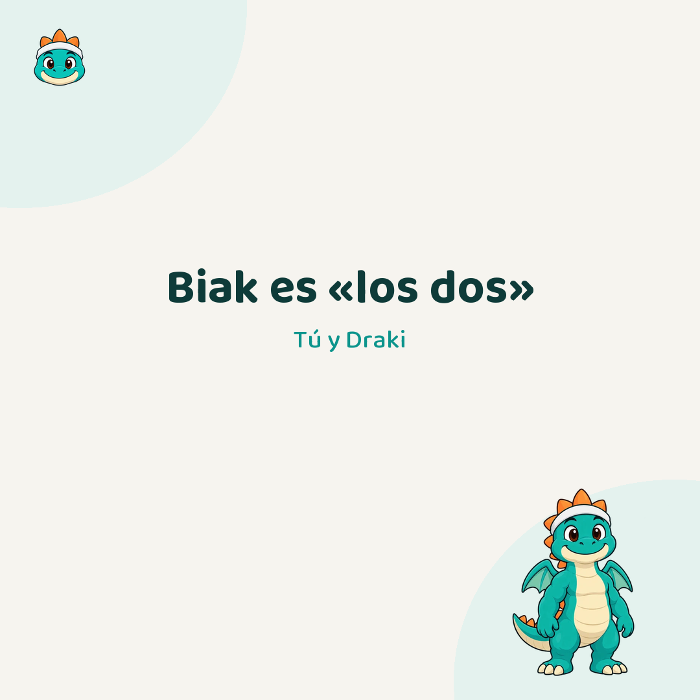

> Biak, en euskera, es «los dos».
> 
> Tú y Draki.
> 
> BiakFit es una app de fuerza para entrenar con lo que tengas: unas mancuernas, una goma o el suelo del salón. Sin gimnasio, sin prisa y sin que nadie te diga que vas tarde.
> 
> Entrenamos juntos.

`#biakfit #entrenamosjuntos #fuerzaencasa #entrenamientoencasa #euskadi #donostia`

*Texto alternativo:* Draki, el dragón de BiakFit, saluda sobre un fondo claro junto al texto «Biak es los dos».

---

## 2 · pesa rusa  (ejercicio, miércoles)

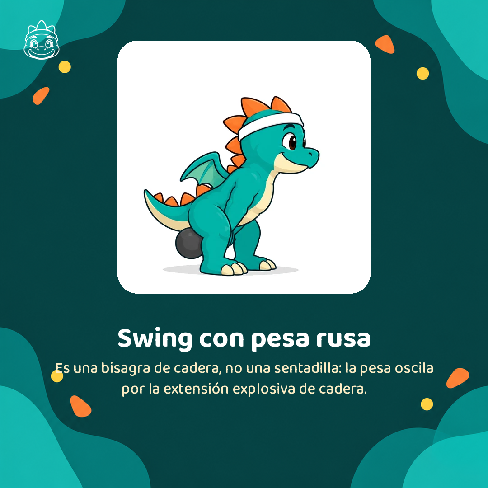

> La pesa rusa no nació en un gimnasio.
> 
> Era el contrapeso con el que se pesaba el grano en los mercados rusos del siglo XVIII. Pesaba un pud: unos 16 kilos, que es justo la más común hoy.
> 
> Los mozos del mercado empezaron a competir con ella por aburrimiento. Dos siglos después sigue aquí.
> 
> Lo que la hace especial es el balanceo: no levantas el peso, lo lanzas con la cadera y lo frenas. Ahí está el trabajo.

`#biakfit #entrenamosjuntos #kettlebell #pesarusa #fuerza #entrenamientoencasa`

*Texto alternativo:* Draki hace un balanceo con pesa rusa: cadera atrás y la pesa entre las piernas.

---

## 3 · primeras semanas  (texto, sábado)

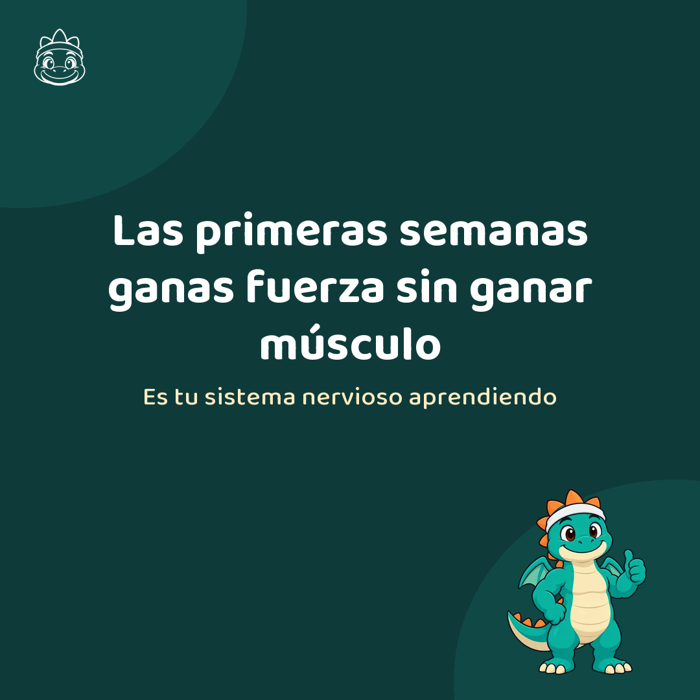

> Las primeras semanas ganas fuerza sin ganar músculo.
> 
> No es magia: es tu sistema nervioso aprendiendo a usar el músculo que ya tienes. Más fibras a la vez, mejor coordinadas.
> 
> Por eso al principio se mejora tan rápido aunque en el espejo no se vea nada. El espejo llega más tarde. La fuerza ya está subiendo.

`#biakfit #entrenamosjuntos #fuerza #constancia #empezar`

*Texto alternativo:* Texto sobre fondo verde oscuro con Draki animando en una esquina.

---

## 4 · flexion  (ejercicio, lunes)

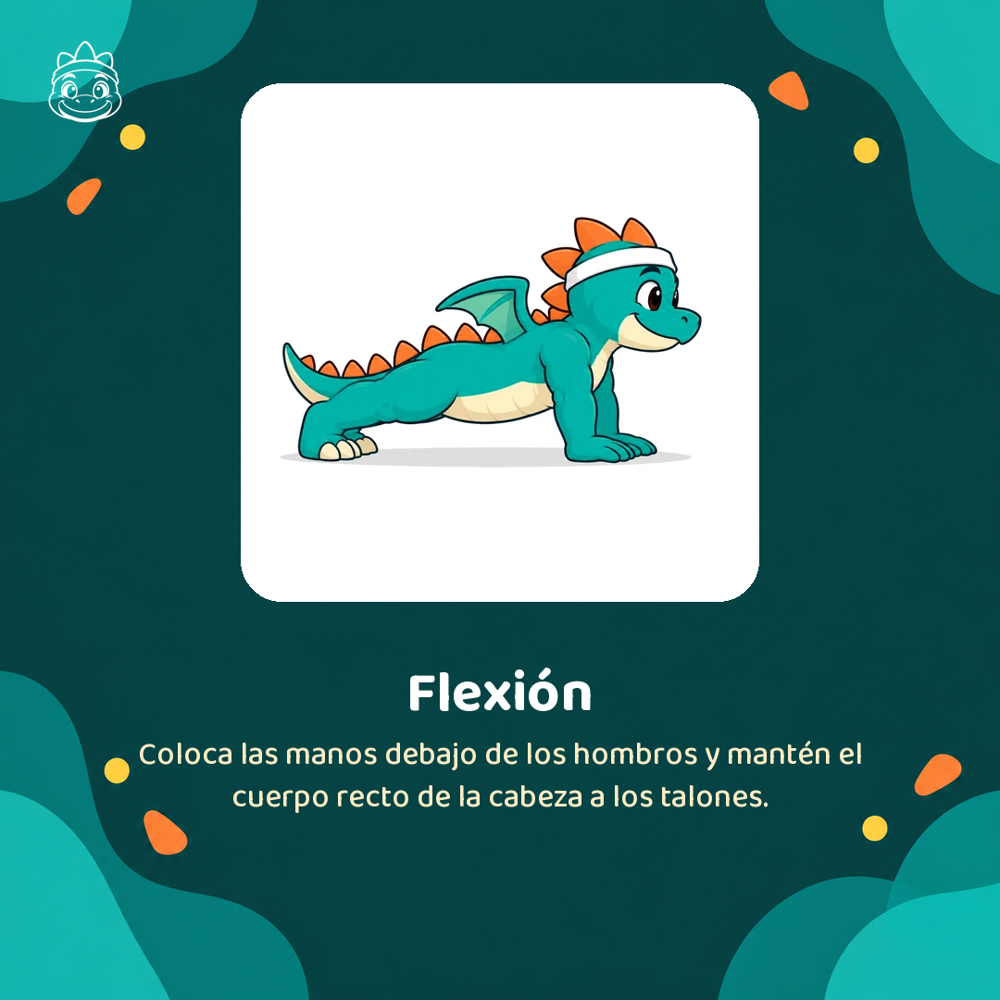

> Flexión.
> 
> Manos debajo de los hombros y el cuerpo recto de la cabeza a los talones. Baja hasta dejar el pecho a un puño del suelo.
> 
> Si la cadera se hunde, aprieta los glúteos. Eso lo arregla casi siempre.
> 
> ¿Todavía no te sale ninguna? Las de rodillas también son flexiones. Empieza ahí.

`#biakfit #entrenamosjuntos #flexiones #pesocorporal #entrenamientoencasa`

*Texto alternativo:* Draki en posición de flexión, con el cuerpo recto de la cabeza a los talones.

---

## 5 · dia que no apetece  (texto, miércoles)

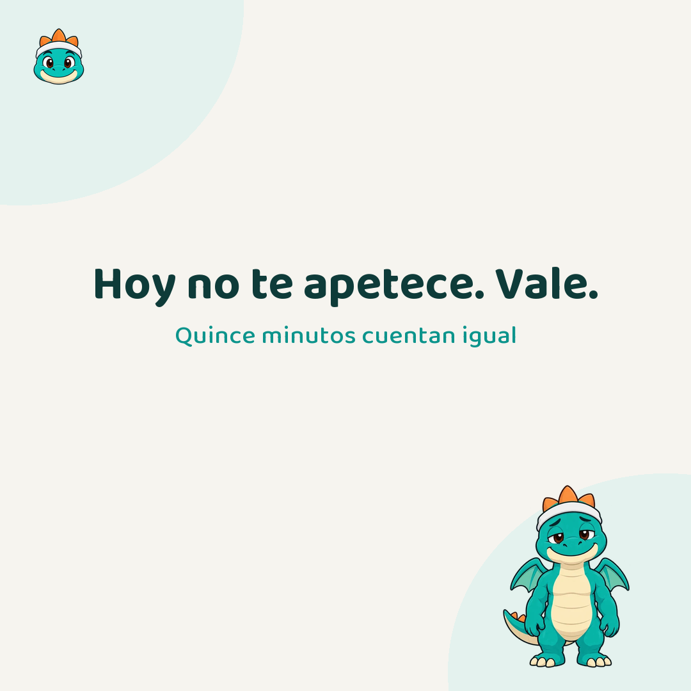

> Hoy no te apetece. Vale.
> 
> Quince minutos de core y peso corporal cuentan igual. No por los quince minutos: por no romper la cadena.
> 
> Lo que te hace fuerte no es la sesión perfecta. Es la sesión número cuarenta.

`#biakfit #entrenamosjuntos #constancia #habitos #sinculpa`

*Texto alternativo:* Draki dormido sobre un fondo claro, junto al texto «Hoy no te apetece. Vale».

---

## 6 · campana muda  (ejercicio, sábado)

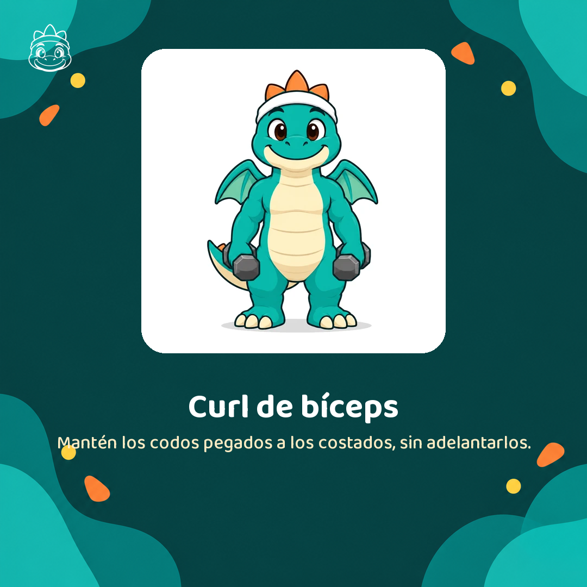

> En inglés, mancuerna se dice dumbbell: campana muda.
> 
> Y es literal. En la Inglaterra del siglo XVIII, los campaneros entrenaban con campanas a las que habían quitado el badajo, para practicar sin despertar al pueblo entero.
> 
> Aquellas campanas mudas acabaron convertidas en barras con peso en los extremos. El nombre se quedó.

`#biakfit #entrenamosjuntos #mancuernas #historia #fuerza`

*Texto alternativo:* Draki hace un curl de bíceps con mancuerna, con los codos pegados al cuerpo.

---

## 7 · agujetas  (texto, lunes)

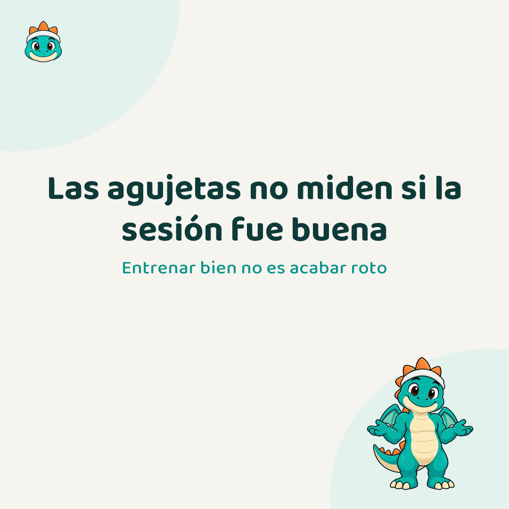

> Las agujetas no miden si la sesión fue buena.
> 
> Aparecen entre 24 y 48 horas después, sobre todo cuando haces algo nuevo o frenas mucho peso. Con las semanas, el mismo entrenamiento deja de darlas.
> 
> Y sigue funcionando igual.
> 
> Entrenar bien no es acabar roto. Es poder volver el jueves.

`#biakfit #entrenamosjuntos #agujetas #recuperacion #constancia`

*Texto alternativo:* Draki se encoge de hombros junto al texto «Las agujetas no miden si la sesión fue buena».

---

## 8 · por que preguntamos  (texto, miércoles)

> La app no te sube el peso porque haya pasado una semana.
> 
> Te lo sube cuando tú dices que la serie te resultó fácil. Y cuando dices que no pudiste, baja.
> 
> Subir por calendario es cómodo de programar y es la forma más rápida de que alguien lo deje: al que le costaba, le cuesta más cada semana.
> 
> Por eso después de cada ejercicio hay una pregunta de tres botones.

`#biakfit #entrenamosjuntos #entrenamientopersonalizado #fuerza`

*Texto alternativo:* Texto sobre fondo verde oscuro con Draki pensativo en una esquina.

---

## 9 · sentadilla  (ejercicio, sábado)

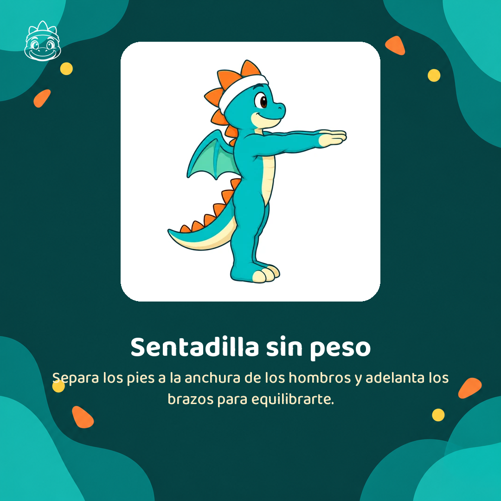

> Sentadilla.
> 
> Es el gesto de sentarse y levantarse, que haces veinte veces al día sin pensarlo. Entrenarlo es entrenar a levantarte del sofá a los ochenta.
> 
> Pies a la anchura de las caderas, pecho alto, y bajas sentándote hacia atrás. Si te cuesta el equilibrio, hazla delante de una silla y tócala con el culo antes de subir.

`#biakfit #entrenamosjuntos #sentadillas #pesocorporal #piernas`

*Texto alternativo:* Draki hace una sentadilla sin peso, con el pecho alto y la cadera atrás.

---

## 10 · crece descansando  (texto, lunes)

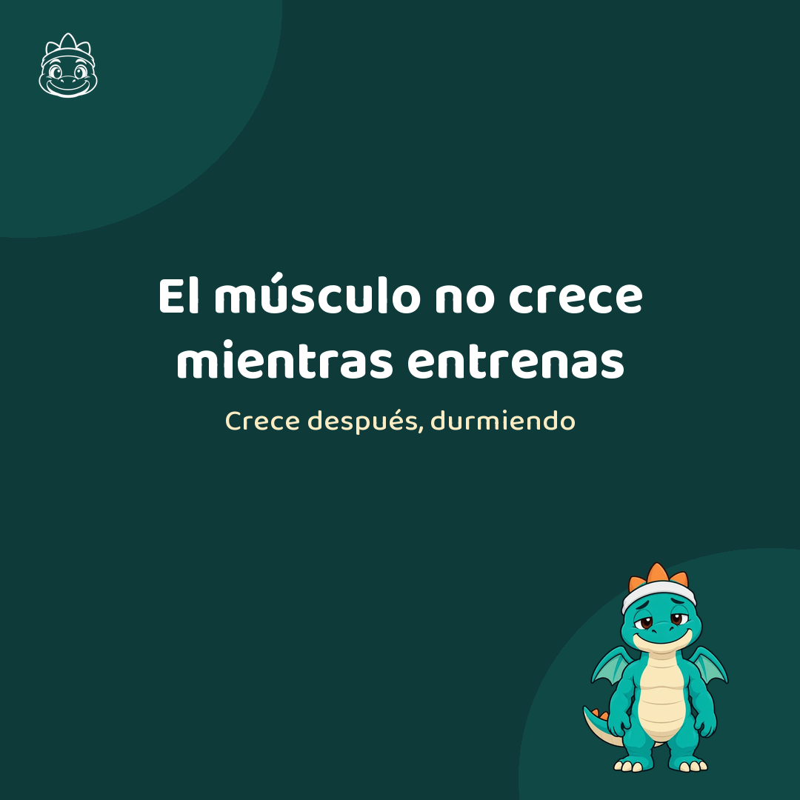

> El músculo no crece mientras entrenas. Crece después.
> 
> La sesión es el aviso; la obra se hace en las horas siguientes, durmiendo. Por eso un plan que no tiene días de descanso no es un plan duro: es un plan mal hecho.
> 
> En BiakFit el descanso está dentro del viaje, no es lo que pasa cuando fallas.

`#biakfit #entrenamosjuntos #descanso #recuperacion #constancia`

*Texto alternativo:* Draki dormido sobre fondo verde oscuro junto al texto «El músculo no crece mientras entrenas».

---

## 11 · gomas  (texto, miércoles)

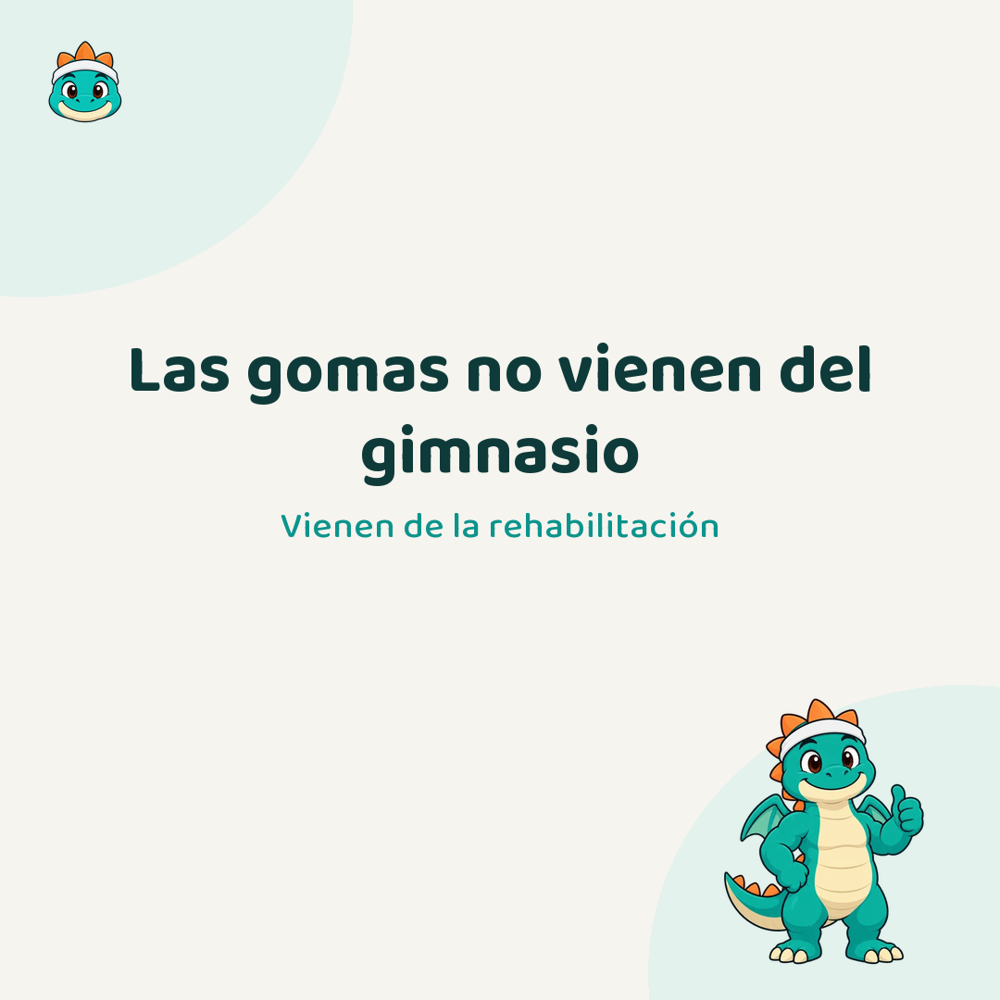

> Las gomas elásticas no vienen del gimnasio: vienen de la rehabilitación.
> 
> Se popularizaron a finales de los setenta como herramienta de fisioterapia, para poder graduar la resistencia de un ejercicio sin cargar peso sobre una articulación.
> 
> Hoy caben en un bolsillo y abren ejercicios de espalda que sin material no existen. Si entrenas en casa y solo vas a comprar una cosa, que sea esto.

`#biakfit #entrenamosjuntos #gomaselasticas #entrenamientoencasa #espalda`

*Texto alternativo:* Draki animando junto al texto «Las gomas no vienen del gimnasio».

---

## 12 · la vuelta  (texto, sábado)

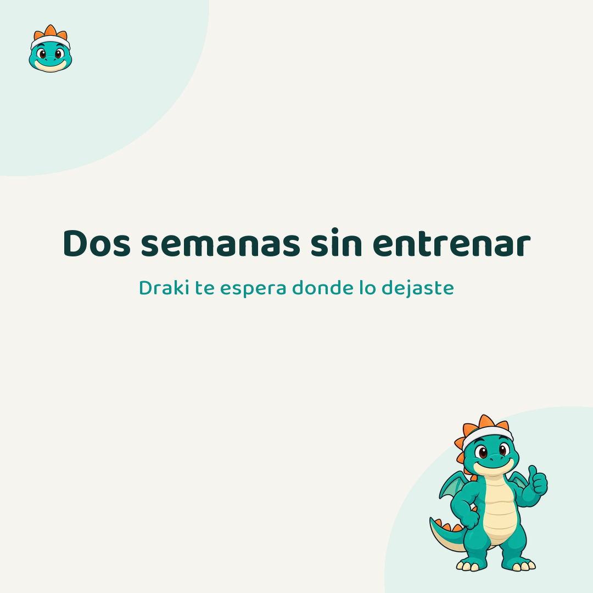

> Dos semanas sin entrenar.
> 
> Draki no te dice nada. Te espera donde lo dejaste, con las mismas cargas y la misma sesión pendiente.
> 
> Volver no es empezar de cero. Es volver.

`#biakfit #entrenamosjuntos #volver #constancia #sinculpa`

*Texto alternativo:* Draki animando sobre fondo claro junto al texto «Dos semanas sin entrenar».

---

## Lo que no se ha contado, y por qué

- Los halteres griegos «como primeras mancuernas»: existieron, pero se usaban para saltar de longitud.
- Los récords de plancha: cambian cada año y envejecen mal.
- «El 80 % lo deja en enero»: se repite en todas partes sin fuente.
