# Lote 2

Cuatro semanas a tres por semana, como el lote 1: lunes 7:30, miércoles 19:00, sábado 10:30. Los cinco tipos de REDES.md van en «categoria» (ejercicio 3, material 2, dato 3, biakfit 2, draki 2); «tipo» sigue siendo el formato que entienden los scripts. El euskera lo he escrito yo y va con eu_revisado: false; en «eu_palabras_nuevas» están las palabras que no salen del catálogo de la app. Fuentes: OMS 2020 (fuerza dos días o más por semana); Schoenfeld, Grgic, Ogborn y Krieger 2017 (21 estudios: crecimiento parecido con carga baja y alta cerca del fallo); Bickel 2011 y Spiering 2021 (mantener con una fracción de la dosis sin bajar la carga), las tres en docs/EVIDENCIA_PROGRESION.md u OBJETIVOS.md. La historia del press en el suelo y de las barras de esferas está en cualquier historia del levantamiento de pesas; sin nombres ni fechas exactas a propósito.

## 1 · dos dias  (texto, lunes)

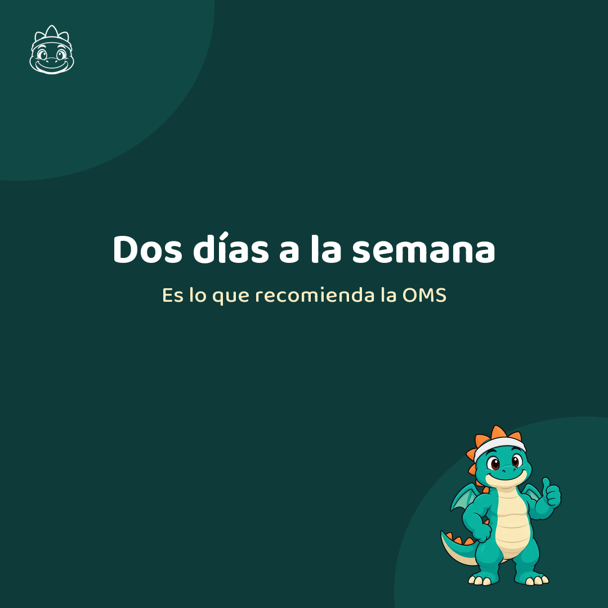

> Bi egun astean. Osasunaren Mundu Erakundeak hori gomendatzen die helduei indarrari dagokionez: bi egun edo gehiago, muskulu-talde handiak landuz. Ez du gimnasiorik, ordubeterik edo makinarik eskatzen. Horregatik eskatzen dizu BiakFitek gutxienez bi egun aukeratzeko.
> 
> · · ·
> 
> Dos días a la semana.
> 
> Es lo que la Organización Mundial de la Salud recomienda de fuerza para adultos: dos días o más, trabajando los grandes grupos musculares.
> 
> No dice gimnasio, ni una hora, ni máquinas. Dice dos días.
> 
> Por eso BiakFit no te deja elegir menos de dos. A partir de ahí, los que de verdad puedas.
> 
> · · ·
> 
> Two days a week. That is what the World Health Organization recommends for strength in adults: two or more days, working the major muscle groups. No gym, no hour, no machines. That is why BiakFit asks you to pick at least two.
> 
> #biakfit #entrenamosjuntos #fuerza #entrenamientoencasa #constancia #habitos

*Texto alternativo:* Texto «Dos días a la semana» sobre fondo verde oscuro, con Draki animando en una esquina.

---

## 2 · puente gluteo  (ejercicio, miércoles)

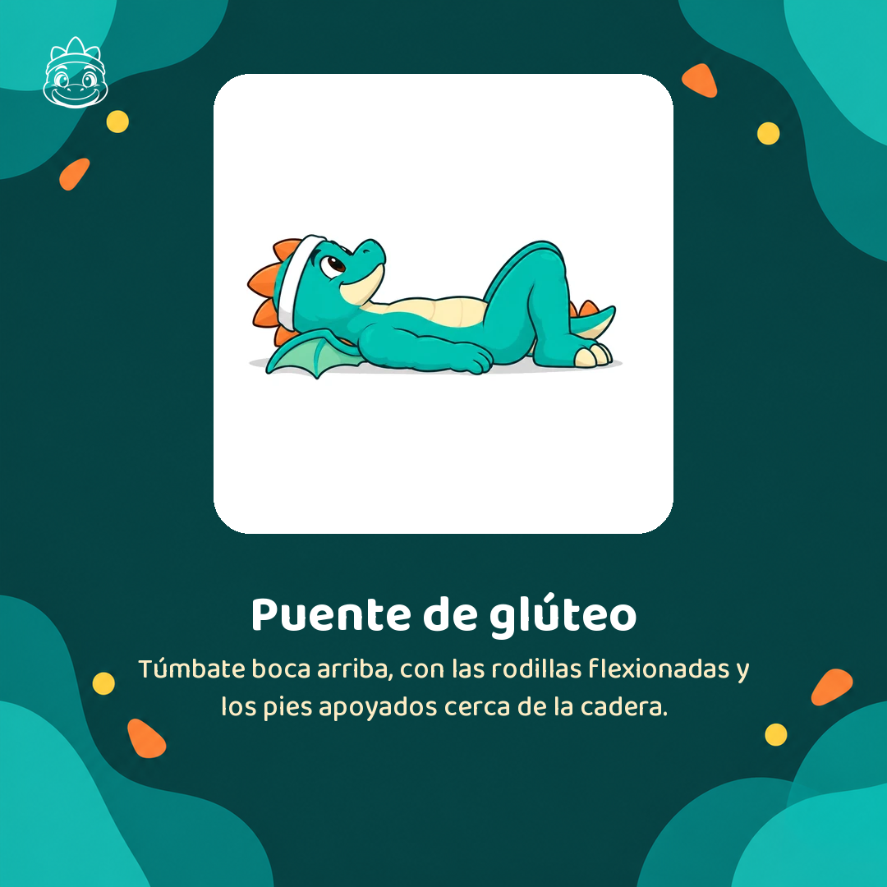

> Gluteo-zubia. Gluteo nagusia gorputzeko muskulurik handiena da, eta bizitzaren erdia ematen dugu haren gainean eserita. Bultzatu orpoekin, altxatu aldakak gorputza lerrokatuta geratu arte eta uzkurtu gluteoak segundo batez goian.
> 
> · · ·
> 
> Puente de glúteo.
> 
> El glúteo mayor es el músculo más grande del cuerpo, y pasamos media vida sentados encima de él.
> 
> Túmbate boca arriba, con las rodillas flexionadas y los pies cerca de la cadera. Empuja con los talones y sube hasta que el cuerpo quede en línea. Arriba, aprieta un segundo.
> 
> Si lo notas más detrás del muslo que en el glúteo, acerca un poco los pies.
> 
> · · ·
> 
> Glute bridge. The gluteus maximus is the largest muscle in the body, and we spend half our lives sitting on it. Drive through your heels, lift until your body is a straight line and squeeze for a second at the top.
> 
> #biakfit #entrenamosjuntos #gluteos #pesocorporal #entrenamientoencasa #sinmaterial

*Texto alternativo:* Draki tumbado boca arriba hace un puente de glúteo, con la cadera elevada y las rodillas flexionadas.

---

## 3 · tres sesiones  (texto, sábado)

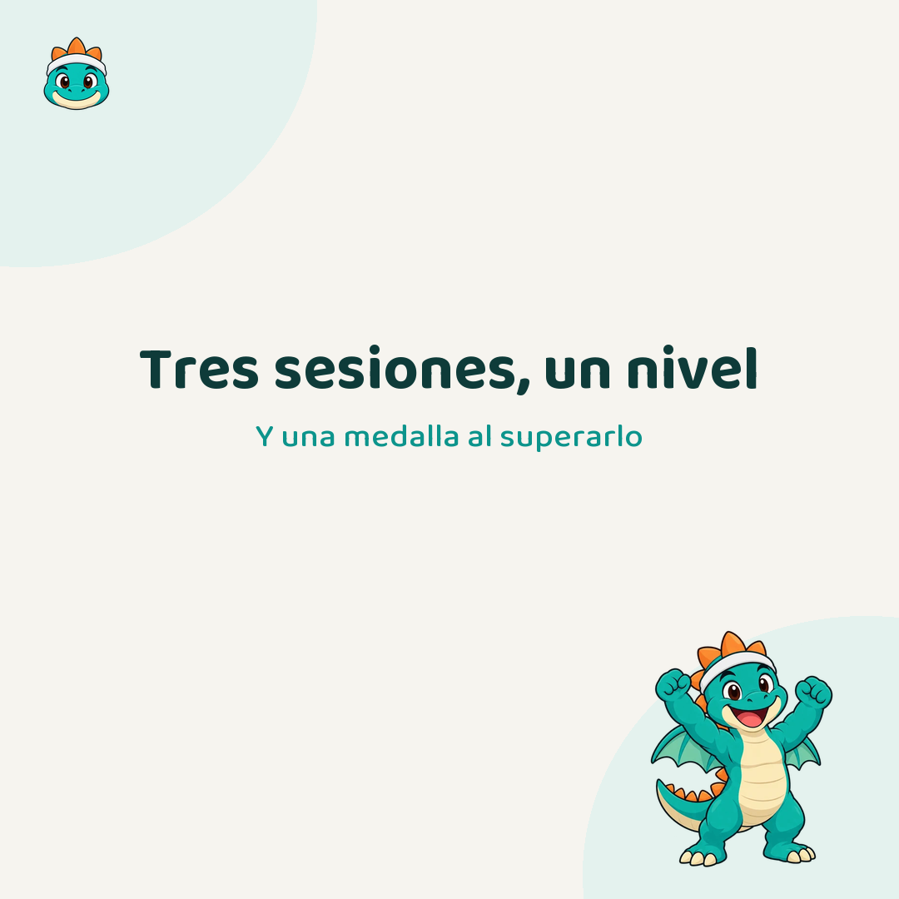

> Hiru saio, maila bat. Drakiren ibilbidea ez da egutegiarekin aurrera joaten, entrenatzen duzunarekin baizik. Hiru saio egin ahala, maila bat gaindituta eta domina bat. Drakik saioak zenbatzen ditu, ez egunak.
> 
> · · ·
> 
> Tres sesiones, un nivel.
> 
> El viaje de Draki no avanza con el calendario: avanza con lo que entrenas. Cada tres sesiones hechas, un nivel superado y una medalla.
> 
> Da igual si las tres caen en una semana o en dos. Draki cuenta sesiones, no días.
> 
> · · ·
> 
> Three sessions, one level. Draki's journey does not move with the calendar, it moves with your training. Every three sessions, a level done and a medal. Draki counts sessions, not days.
> 
> #biakfit #entrenamosjuntos #draki #constancia #habitos #fuerzaencasa

*Texto alternativo:* Draki celebrando sobre fondo claro junto al texto «Tres sesiones, un nivel».

---

## 4 · no se pierde  (texto, lunes)

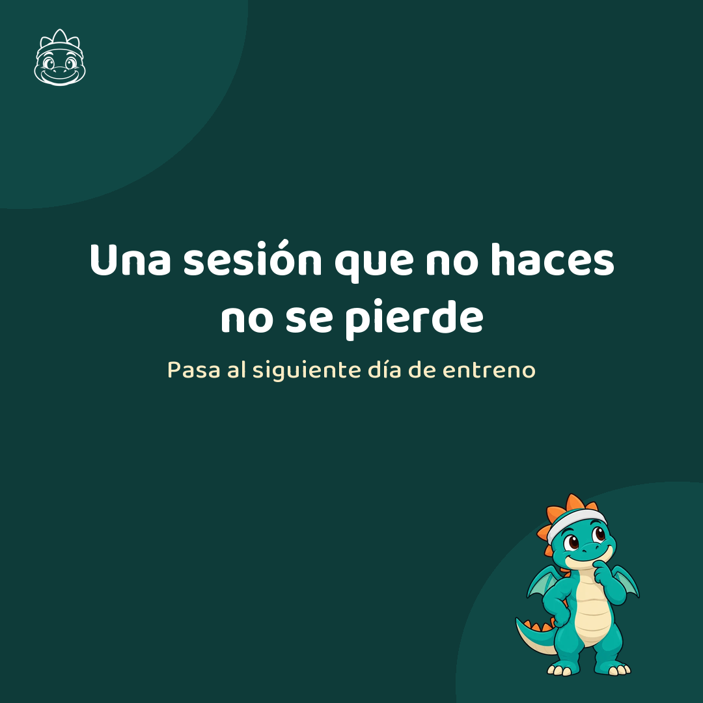

> Egiten ez duzun saioa ez da galtzen. Asteartean ezin baduzu, asteartekoa ez da desagertzen: hurrengo entrenamendu-egunera atzeratzen da, eta plan osoa harekin batera. Ez zoaz berandu: zeunden tokian jarraitzen duzu.
> 
> · · ·
> 
> Una sesión que no haces no se pierde.
> 
> Si el martes no llegas, la sesión del martes no desaparece: pasa al siguiente día que entrenas, y el plan se corre con ella.
> 
> Un plan que tacha lo que no hiciste te dice que vas atrasado. Uno que lo guarda te dice que sigues donde estabas.
> 
> Y eso es lo que pasa de verdad.
> 
> · · ·
> 
> A session you skip is not lost. If you cannot make it on Tuesday, Tuesday's session moves to your next training day and the plan shifts with it. You are not behind. You are where you were.
> 
> #biakfit #entrenamosjuntos #sinculpa #constancia #entrenamientoencasa

*Texto alternativo:* Texto «Una sesión que no haces no se pierde» sobre fondo verde oscuro, con Draki pensativo en una esquina.

---

## 5 · press suelo  (ejercicio, miércoles)

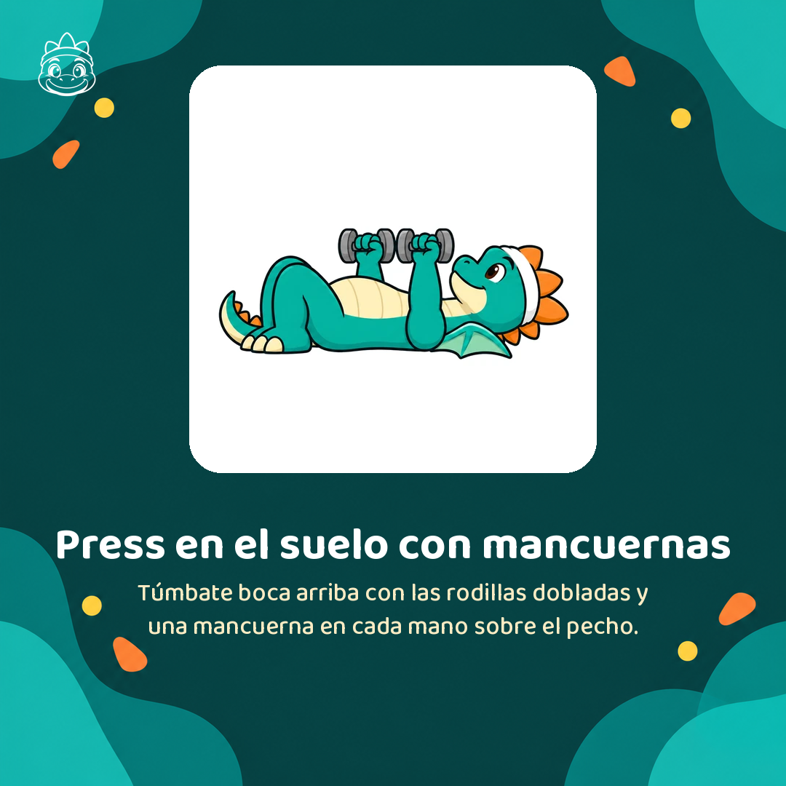

> Bankua baino lehen, lurra zegoen. XX. mendearen hasieran, etzanda egiten zen pressa lurrean egiten zen; bankua mende erdialdean nagusitu zen. Etxean, bankurik gabe, lurrak balio du oraindik: jaitsi mankuernak poliki ukondoek lurra ukitu arte, eta bultzatu gora.
> 
> · · ·
> 
> Antes que el banco, estuvo el suelo.
> 
> A principios del siglo XX, el press tumbado se hacía en el suelo. El banco se fue imponiendo a mediados de siglo, y con él el press de banca que hoy está en todos los gimnasios.
> 
> En casa y sin banco, el suelo sigue funcionando: baja las mancuernas despacio hasta que los codos lo toquen, y empuja.
> 
> El suelo te dice dónde parar. No hay que pensar en nada más.
> 
> · · ·
> 
> Before the bench, there was the floor. In the early 20th century, lying presses were done on the floor; the bench took over around mid-century. At home without a bench, the floor still works: lower the dumbbells slowly until your elbows touch it, then press.
> 
> #biakfit #entrenamosjuntos #mancuernas #historia #entrenamientoencasa #fuerza

*Texto alternativo:* Draki tumbado en el suelo con una mancuerna en cada mano, empujándolas hacia arriba sobre el pecho.

---

## 6 · peso ligero  (texto, sábado)

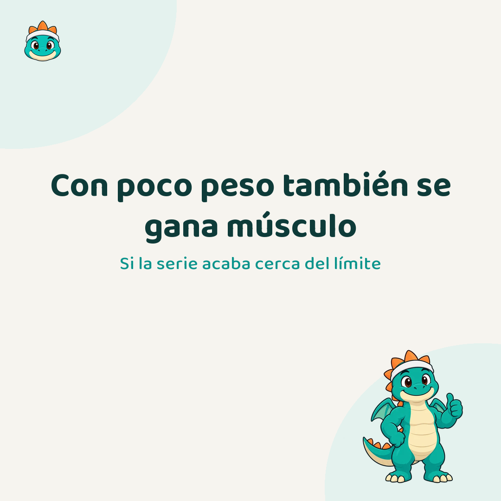

> Pisu gutxirekin ere muskulua irabazten da. Serieak ezin gehiago egiteko mugatik gertu amaitzen direnean, muskulua antzera hazten da karga arinekin eta astunekin; indar maximoak bai eskatzen du pisu handia. Horregatik, zure mankuernarik astunenera iristean, appak ez dizu beste bat erosteko eskatzen: errepikapenak gehitzen dizkizu, eta gero serieak.
> 
> · · ·
> 
> Con poco peso también se gana músculo.
> 
> Cuando las series acaban cerca de no poder más, el músculo crece parecido con cargas ligeras que con pesadas. Lo recogen más de veinte estudios. Lo que sí pide peso alto es la fuerza máxima.
> 
> Por eso, cuando llegas a tu mancuerna más pesada, la app no te pide que compres otra: te sube repeticiones, y después series.
> 
> Las de diez kilos tienen mucho recorrido.
> 
> · · ·
> 
> Light weights build muscle too. When sets end close to failure, muscle grows about the same with light loads as with heavy ones; maximal strength is what needs heavy weight. That is why, when you reach your heaviest dumbbell, the app does not ask you to buy another: it adds reps, then sets.
> 
> #biakfit #entrenamosjuntos #mancuernas #entrenamientoencasa #fuerza #hipertrofia

*Texto alternativo:* Draki animando sobre fondo claro junto al texto «Con poco peso también se gana músculo».

---

## 7 · zancada  (ejercicio, lunes)

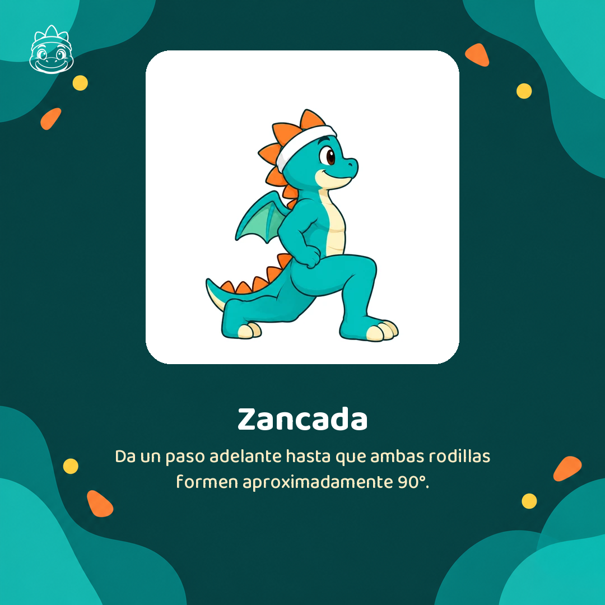

> Aurrerako urratsa. Oinez ibili, eskailerak igo, zerbait hartzeko makurtu: zutik egiten duzun ia guztia hanka banarekin egiten duzu. Aurrerako urratsak hori lantzen du. Oreka galtzen baduzu, zabaldu oinak pixka bat alboetara.
> 
> · · ·
> 
> Zancada.
> 
> Andar, subir escaleras, agacharte a por algo: casi todo lo que haces de pie lo haces con una pierna cada vez. La zancada entrena eso.
> 
> Da un paso adelante hasta que las dos rodillas queden más o menos en ángulo recto, con el tronco erguido. Empuja con el pie de delante para volver.
> 
> Si te tambaleas, separa un poco los pies hacia los lados: como si fueran por dos raíles y no por una cuerda floja.
> 
> · · ·
> 
> Lunge. Walking, climbing stairs, bending down for something: almost everything you do standing, you do one leg at a time. The lunge trains that. If you wobble, widen your stance a little: two rails, not a tightrope.
> 
> #biakfit #entrenamosjuntos #piernas #pesocorporal #sinmaterial #entrenamientoencasa

*Texto alternativo:* Draki da un paso adelante en una zancada, con las dos rodillas flexionadas y el tronco erguido.

---

## 8 · plan se rehace  (texto, miércoles)

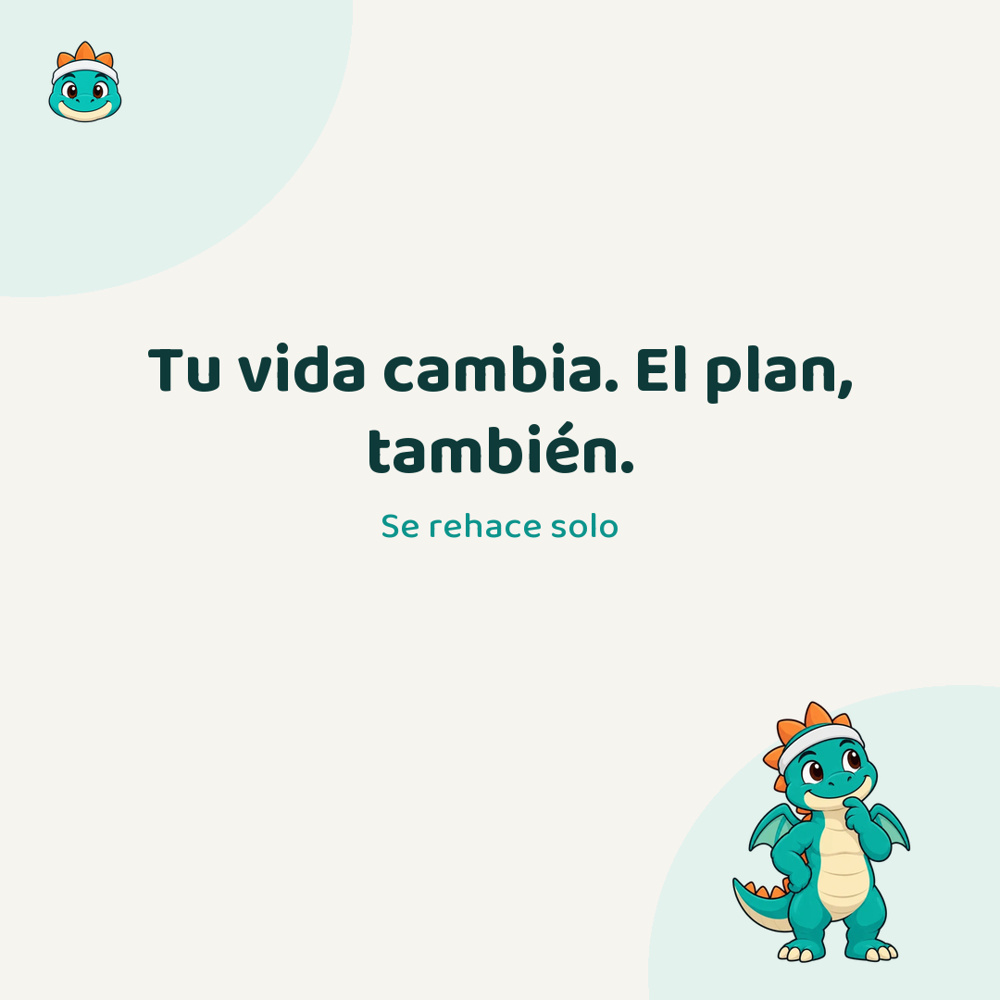

> Zure bizitza aldatzen da. Plana ere bai. Hiru egunetik bi egunera pasatzen bazara, mankuerna batzuk erosten badituzu edo beste helburu bat aukeratzen baduzu, BiakFitek falta zaizkizun saioak zure datu berriekin berregiten ditu. Ibilbideak dagoen tokian jarraitzen du, eta zure pisuak zurekin datoz.
> 
> · · ·
> 
> Tu vida cambia. El plan, también.
> 
> Si pasas de tres días a dos, te compras unas mancuernas o eliges otro objetivo, BiakFit rehace las sesiones que te quedan con tus datos nuevos. Sin tener que acordarte de ningún botón.
> 
> El viaje sigue donde estaba, y las cargas que ya mueves vienen contigo.
> 
> Un plan que se queda con la vida que tenías el día que empezaste no es tu plan.
> 
> · · ·
> 
> Your life changes. So does the plan. Go from three days to two, buy some dumbbells or pick another goal, and BiakFit rebuilds the sessions you have left with your new data. The journey stays where it is, and your weights come with you.
> 
> #biakfit #entrenamosjuntos #entrenamientopersonalizado #entrenamientoencasa #habitos

*Texto alternativo:* Draki pensativo sobre fondo claro junto al texto «Tu vida cambia. El plan, también».

---

## 9 · racha  (texto, sábado)

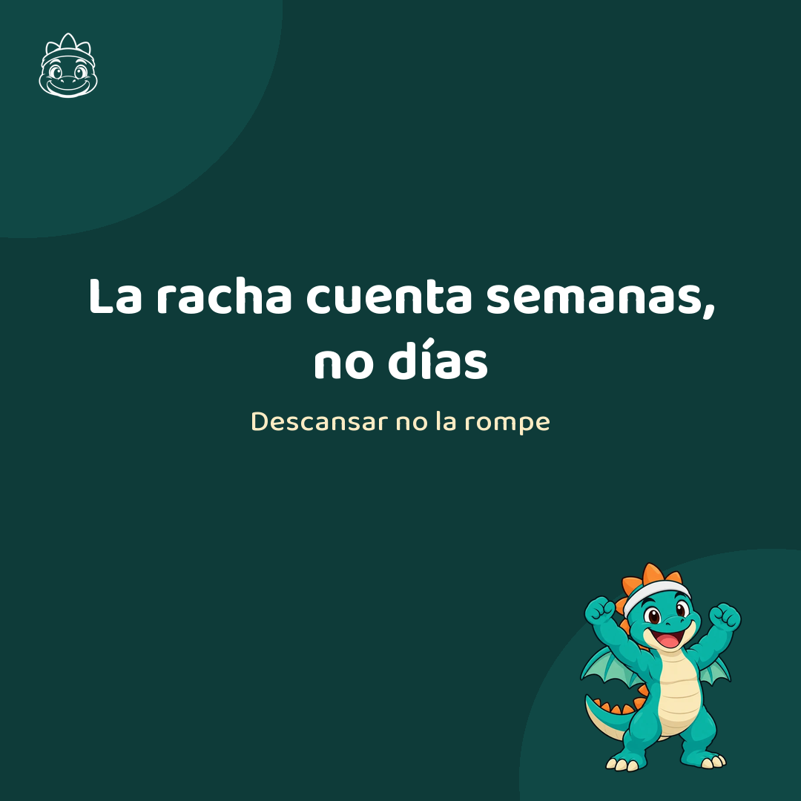

> BiakFiten boladak asteak zenbatzen ditu, ez egunak. Aste bat kontatzen da harentzat aukeratu zenituen saioak egiten badituzu, eta tarteko atseden-egunek ez dute hausten. Drakik ez ditu jarraian egindako egunak zenbatzen: zeure buruarekin bete dituzun asteak zenbatzen ditu.
> 
> · · ·
> 
> La racha de BiakFit cuenta semanas, no días.
> 
> Una semana cuenta si haces las sesiones que elegiste para ella. Los días de descanso entre medias no la rompen: son parte del plan.
> 
> Y si es miércoles y vas a medias, tampoco: la semana todavía no ha terminado.
> 
> Draki no cuenta cuántos días seguidos llevas. Cuenta cuántas semanas has cumplido contigo.
> 
> · · ·
> 
> BiakFit's streak counts weeks, not days. A week counts when you do the sessions you chose for it, and the rest days in between do not break it. Draki does not count days in a row. He counts the weeks you kept your word to yourself.
> 
> #biakfit #entrenamosjuntos #racha #constancia #descanso #sinculpa

*Texto alternativo:* Texto «La racha cuenta semanas, no días» sobre fondo verde oscuro, con Draki celebrando en una esquina.

---

## 10 · mantener  (texto, lunes)

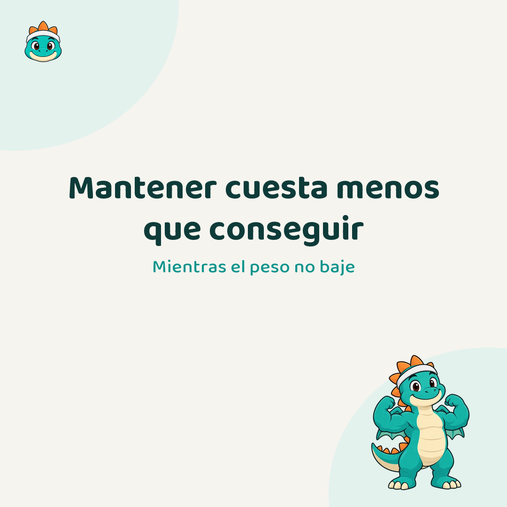

> Indarra mantentzeak irabazteak baino askoz gutxiago eskatzen du. Hura lortzeko behar izan zen entrenamenduaren zati txiki batekin, indarra eta muskulua mantendu egiten dira, baldintza bakar batekin: mugitzen duzun pisua ez jaistea. Gutxiago egin daiteke, ez arinago. Ondo dagoenarentzat eta horrela jarraitu nahi duenarentzat, BiakFitek helburu propio bat du: «Dudana mantendu».
> 
> · · ·
> 
> Mantener la fuerza cuesta bastante menos que conseguirla.
> 
> Con una fracción del entrenamiento que hizo falta para ganarlos, la fuerza y el músculo se sostienen. La condición es una: que el peso que mueves no baje. Se puede hacer menos, no más ligero.
> 
> Para quien ya está bien y quiere seguir así, BiakFit tiene un objetivo propio: mantenerme. Tres series, descansos cortos y sin bajar la carga.
> 
> · · ·
> 
> Keeping strength costs a lot less than gaining it. With a fraction of the training it took to build, strength and muscle hold, as long as the weight you lift does not drop. You can do less, not lighter. For anyone who is fine and wants to stay that way, BiakFit has its own goal: keep what I have.
> 
> #biakfit #entrenamosjuntos #fuerza #constancia #habitos #entrenamientoencasa

*Texto alternativo:* Draki orgulloso sobre fondo claro junto al texto «Mantener cuesta menos que conseguir».

---

## 11 · barra esferas  (ejercicio, miércoles)

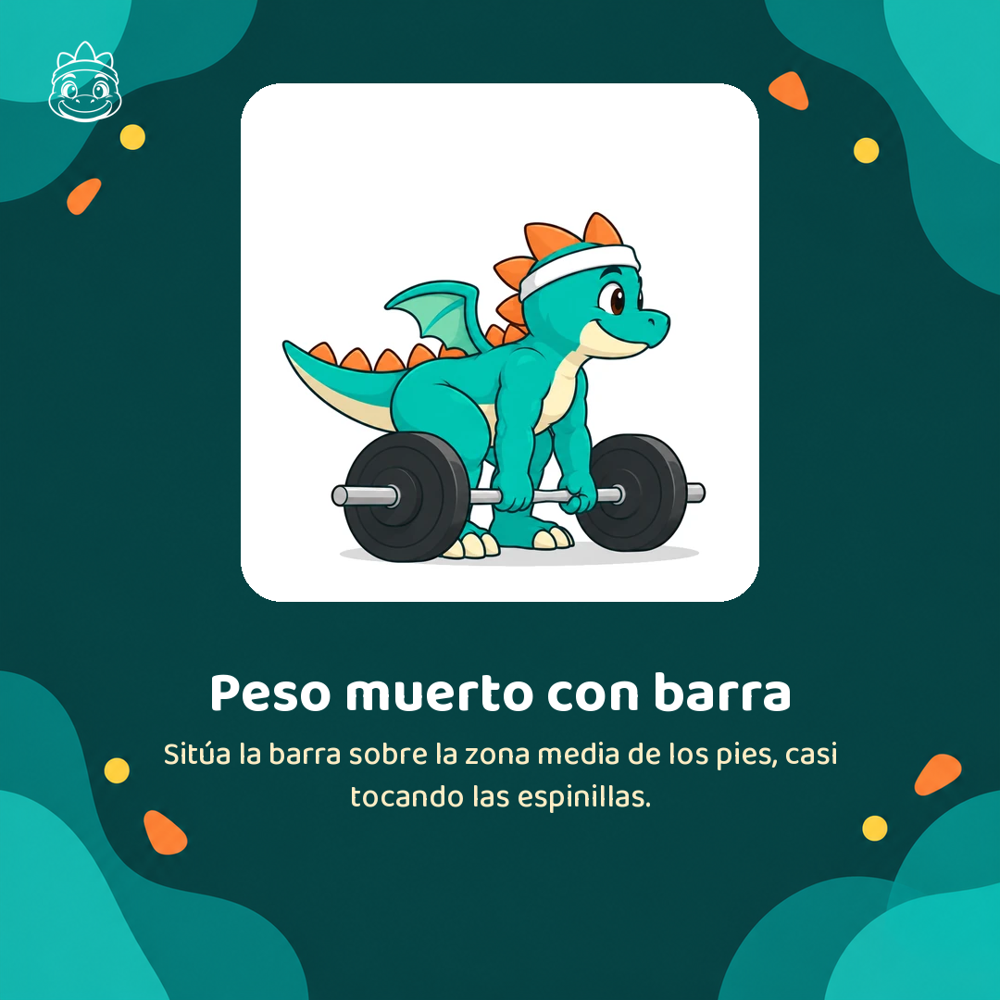

> Lehen barrak bi bola eta makila bat ziren. XIX. mendean, barrak esfera huts bat zeraman mutur bakoitzean, eta pisua aldatzeko harea edo perdigoiak sartzen zitzaizkien. Jarri eta kendu daitezkeen diskoak XX. mendearen hasieran iritsi ziren, eta haiekin batera gaur ezagutzen dugun barra.
> 
> · · ·
> 
> Las primeras barras eran dos bolas y un palo.
> 
> En el siglo XIX, la barra de pesas llevaba una esfera hueca en cada extremo. Para cambiar el peso se abrían y se llenaban de arena o de perdigones.
> 
> Los discos que se ponen y se quitan llegaron a principios del siglo XX, y con ellos la barra que conocemos.
> 
> Con ella, el peso muerto: barra sobre el centro del pie, espalda recta antes de despegarla, y empuja el suelo.
> 
> · · ·
> 
> The first barbells were two balls and a stick. In the 19th century each end carried a hollow globe, filled with sand or lead shot to change the weight. Plates you can load and unload arrived in the early 20th century, and with them the barbell we know.
> 
> #biakfit #entrenamosjuntos #pesomuerto #barra #historia #fuerza

*Texto alternativo:* Draki hace un peso muerto con barra: la barra sobre el centro del pie y la espalda recta.

---

## 12 · bird dog  (ejercicio, sábado)

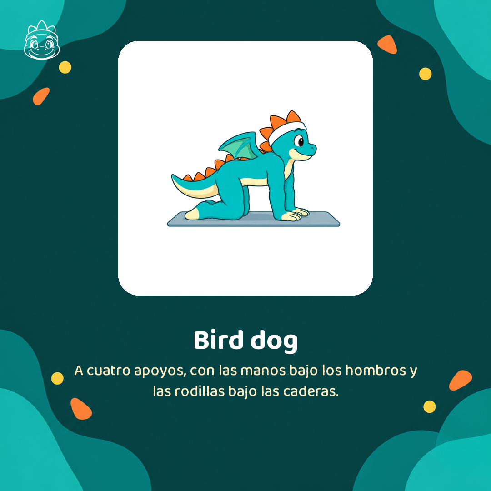

> Bird dog. Ezer gutxi dirudi: lau hankatan, beso bat aurrera eta kontrako hanka atzera luzatzen dituzu. Zaila ez da haiek mugitzea, gainerako gorputza geldi mantentzea baizik. Imajinatu ur-edalontzi bat bizkar gainean. Isuriko balitz, joan polikiago.
> 
> · · ·
> 
> Bird dog.
> 
> Parece poca cosa: a cuatro apoyos, estiras un brazo y la pierna contraria. Lo difícil no es moverlos, es que el resto del cuerpo no se mueva.
> 
> Imagina un vaso de agua sobre la espalda. Si se fuera a derramar, ve más despacio o estira menos.
> 
> Es de los que caben en cualquier día, también en uno que no te apetece nada.
> 
> · · ·
> 
> Bird dog. It looks like nothing: on all fours, reach one arm forward and the opposite leg back. The hard part is not moving them, it is keeping everything else still. Picture a glass of water on your back. If it would spill, slow down.
> 
> #biakfit #entrenamosjuntos #core #espalda #sinmaterial #entrenamientoencasa

*Texto alternativo:* Draki a cuatro apoyos estira un brazo hacia delante y la pierna contraria hacia atrás.

---

## Lo que no se ha contado, y por qué

- La semana de descarga como post de «cómo lo hace BiakFit»: la app la hace, pero EVIDENCIA_PROGRESION.md dice que la evidencia no la respalda. No se presume de lo que no está probado.
- «Descansar tres minutos entre series da más músculo» (Schoenfeld 2016): es cierto, pero contradice los 45 segundos de mantenerme y los descansos cortos de perder peso. Sería prometer lo contrario de lo que hace la app.
- Alan Calvert y la Milo Barbell de 1902 como «inventor del disco»: se repite mucho, pero el «primero» es discutible. Se cuenta la época y no el nombre.
